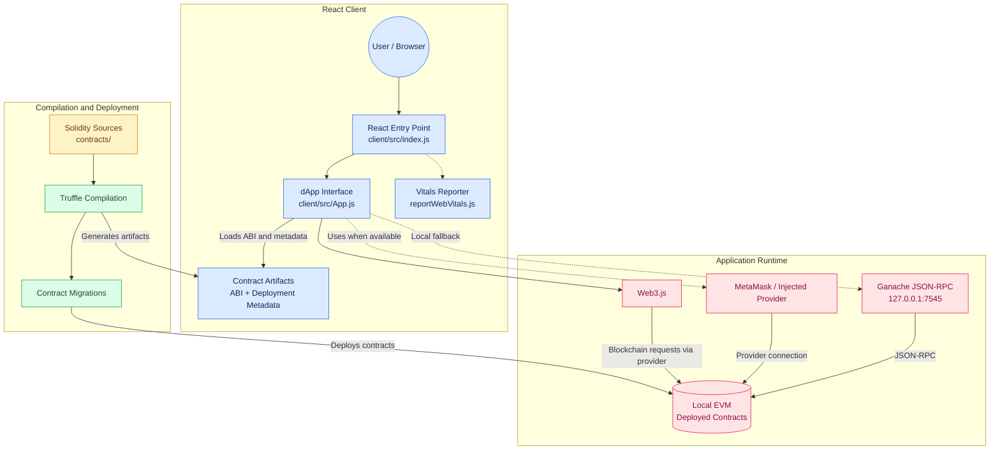
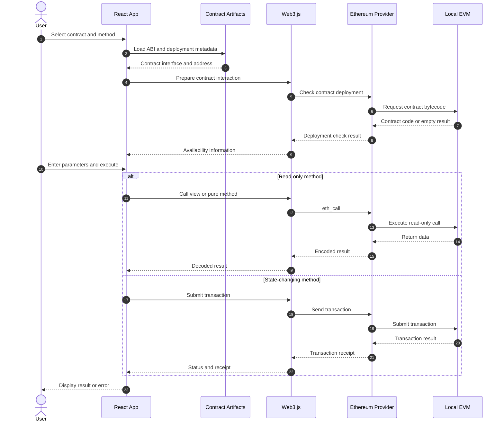

# ⛓️ Solidity Smart Contract Playground

<p align="center">
  <strong>An interactive decentralized application for exploring Ethereum smart contracts.</strong>
</p>

<p align="center">
  
  
  
  
  
</p>

## 📌 Overview

**Solidity Smart Contract Playground** is an educational decentralized application (dApp) built with React, Web3.js, Solidity, Truffle, and Ganache.

The project provides a web interface for exploring and interacting with Solidity smart contracts deployed on a local Ethereum-compatible blockchain. It brings together several exercises covering arithmetic operations, Ether unit conversion, string manipulation, conditional logic, dynamic arrays, inheritance, and ETH payments.

The React frontend uses contract artifacts generated by Truffle to access contract ABIs and deployment information. Web3.js connects the application to an Ethereum provider, enabling users to call contract methods, submit transactions, inspect blockchain information, and explore contract events.

This project demonstrates how frontend development, smart contract engineering, and blockchain infrastructure work together in a decentralized application.

## ✨ Features

### 🔗 Blockchain Connectivity
- Connect to an injected Ethereum provider such as MetaMask.
- Fall back to a local Ganache JSON-RPC endpoint when an injected provider is unavailable.
- Display blockchain network and account information.
- Inspect the current account balance and latest block information.
- Handle account and network changes where supported by the provider.

### 📜 Smart Contract Explorer
- Explore multiple Solidity contracts through a React interface.
- Load contract ABIs and deployment metadata from Truffle artifacts.
- Inspect available contract methods.
- Provide arguments through dynamically generated form inputs.
- Display return values and execution errors.

### ⚡ Contract Interaction
- Execute read-only methods using Ethereum calls.
- Submit state-changing transactions through a compatible provider.
- Supply ETH values when invoking payable methods.
- Inspect transaction status and related blockchain information.
- Check contract deployment information before attempting interactions.

### 📡 Event Inspection
- Query events emitted by deployed contracts.
- Display event and transaction information.
- Refresh event information periodically.

### 🧪 Solidity Learning Exercises
- Arithmetic and comparison operations.
- Ether and Wei conversion.
- String manipulation.
- Conditional statements and parity checking.
- Dynamic arrays and aggregation.
- Abstract contracts and inheritance.
- Payable functions, ETH transfers, and access restrictions.

## 🏗️ System Architecture

The architecture is organized around four main components: the React client, Solidity contracts, the Truffle compilation and deployment workflow, and the local Ethereum-compatible blockchain.



**Architecture notes**

- `client/src/index.js` initializes the React application and renders the main interface.
- `client/src/App.js` manages the dApp interface and contract interactions.
- Truffle compiles the Solidity sources and generates JSON artifacts containing contract ABIs and bytecode.
- Deployment migrations deploy compiled contracts and record their network-specific deployment information.
- Web3.js communicates with the blockchain through an Ethereum provider.
- MetaMask can provide an injected provider, while Ganache exposes a local JSON-RPC endpoint.
- The application contains provider-selection logic, so the provider used for an operation may depend on the execution path.

The diagram represents the application structure and development workflow. It is a simplified architecture view rather than a trace of every provider call.

## 🔄 Smart Contract Interaction Flow

The following sequence illustrates how a user interacts with a contract from the React interface.



**Important:** this sequence illustrates the general interaction workflow. Actual provider selection, transaction signing, and receipt handling depend on the implementation and the active network.

## 📚 Smart Contracts

The repository includes the following Solidity exercises.

| Contract | Source File | Purpose |
|---|---|---|
| `Addition` | `contracts/Exercice1.sol` | Demonstrates arithmetic operations and function parameters. |
| `Convertisseur` | `contracts/Exercice2.sol` | Demonstrates conversion between Ether and Wei. |
| `GestionChaines` | `contracts/Exercice3.sol` | Explores string storage, concatenation, comparison, and related operations. |
| `Positif` | `contracts/Exercice4.sol` | Checks whether an integer is positive. |
| `Parite` | `contracts/Exercice5.sol` | Checks the parity of an integer. |
| `Tableau` | `contracts/Exercice6.sol` | Demonstrates dynamic arrays, element access, and aggregation. |
| `Forme` | `contracts/Exercice7/Form.sol` | Defines an abstract shape contract. |
| `Rectangle` | `contracts/Exercice7/Rectangle.sol` | Extends `Forme` with rectangle dimensions and area calculation. |
| `Payment` | `contracts/Exercice8.sol` | Demonstrates receiving ETH, access restrictions, and balance withdrawal. |

### Key Solidity Concepts

**Arithmetic and conditions**

`Addition`, `Positif`, and `Parite` demonstrate basic computation, comparisons, and conditional logic.

**Unit conversion and strings**

`Convertisseur` illustrates Ether denomination handling, while `GestionChaines` explores Solidity string operations.

**Data structures**

`Tableau` demonstrates storing and processing values in a dynamic array.

**Abstraction and inheritance**

`Forme` defines a shared abstraction, and `Rectangle` provides a concrete implementation of shape-related behavior.

**Payments and access restrictions**

`Payment` demonstrates payable functions, contract balances, event emission, and restricted withdrawals.

> These contracts are educational examples. Their presence in the project does not imply that they have undergone a security audit.

## 🛠️ Technology Stack

| Technology | Purpose |
|---|---|
| **Solidity 0.8.21** | Implements the smart contracts. |
| **React 19** | Builds the browser-based user interface. |
| **Web3.js 4.x** | Connects the frontend to Ethereum-compatible providers and contracts. |
| **Truffle** | Compiles contracts, generates artifacts, and manages deployment migrations. |
| **Ganache** | Provides a local Ethereum-compatible blockchain for development. |
| **MetaMask** | Provides an optional browser wallet and injected Ethereum provider. |
| **JavaScript** | Implements the React application and blockchain integration. |
| **Mermaid** | Documents the architecture and interaction workflows. |

## 📂 Project Structure

```text
blockchain_project/
├── client/
│   ├── public/
│   ├── src/
│   │   ├── contracts/              # Generated Truffle contract artifacts
│   │   ├── App.js                  # Main dApp interface
│   │   ├── index.js                # React entry point
│   │   └── reportWebVitals.js      # Performance measurement helper
│   └── package.json                # Frontend dependencies and scripts
├── contracts/
│   ├── Exercice1.sol                # Addition
│   ├── Exercice2.sol                # Ether/Wei conversion
│   ├── Exercice3.sol                # String operations
│   ├── Exercice4.sol                # Positive-number check
│   ├── Exercice5.sol                # Parity check
│   ├── Exercice6.sol                # Dynamic arrays
│   ├── Exercice7/
│   │   ├── Form.sol                 # Abstract shape
│   │   └── Rectangle.sol            # Rectangle implementation
│   └── Exercice8.sol                # ETH payment
├── migrations/                      # Contract deployment migrations
├── test/                            # Contract test files, if configured
├── truffle-config.js                # Truffle and compiler configuration
└── README.md
```

The JSON artifacts generated by Truffle provide the frontend with the contract ABI and, after deployment, the network-specific contract addresses.

## ⚙️ Prerequisites

Install or prepare the following tools:

- **Node.js and npm**
- **Truffle CLI** or the ability to run it through `npx`
- **Ganache Desktop or Ganache CLI**
- **MetaMask**, if you want to test injected-wallet interactions
- **Git**

Verify Node.js and npm:

```bash
node --version
npm --version
```

Verify Truffle if installed globally:

```bash
truffle version
```

## 🚀 Installation and Setup

### 1. Clone the Repository

```bash
git clone https://github.com/Ellouzati-Mohammed/blockchain_project.git
cd blockchain_project
```

### 2. Install Frontend Dependencies

```bash
cd client
npm install
cd ..
```

### 3. Start Ganache

The application is configured to use the local JSON-RPC endpoint:

```text
http://127.0.0.1:7545
```

Start Ganache Desktop with its RPC server configured to use port `7545`, or start a compatible Ganache CLI instance:

```bash
npx ganache --server.port 7545
```

Keep Ganache running while compiling, deploying, and testing the contracts.

### 4. Configure the Truffle Development Network

The published `truffle-config.js` has a development network configuration that may need to be enabled. Ensure that the `networks` section contains a matching entry:

```javascript
networks: {
  development: {
    host: "127.0.0.1",
    port: 7545,
    network_id: "*"
  }
}
```

Preserve the existing compiler configuration and artifact output directory. The frontend expects the generated artifacts under `client/src/contracts`.

### 5. Compile the Smart Contracts

From the project root:

```bash
npx truffle compile
```

Compilation generates the contract artifacts, including ABI and bytecode information.

### 6. Deploy the Contracts

With Ganache running and the `development` network configured:

```bash
npx truffle migrate --reset --network development
```

After a successful migration, Truffle records deployment information for the configured network in the generated contract artifacts.

If the migration command fails, check that Ganache is running on port `7545` and that the Truffle network configuration matches it.

### 7. Start the React Application

```bash
cd client
npm start
```

Open the local URL shown in the terminal. For a standard Create React App setup, this is usually:

```text
http://localhost:3000
```

The exact command and development URL depend on the scripts configured in `client/package.json`.

## 🧑‍💻 Using the Application

1. Start Ganache and deploy the contracts.
2. Launch the React frontend.
3. Check the network and account information displayed by the interface.
4. Select a Solidity contract from the available contract catalogue.
5. Choose a method and provide its required parameters.
6. Execute a read-only method to inspect the returned value, or submit a transaction to change contract state.
7. When testing `Payment`, specify the intended ETH value in Wei for payable calls.
8. Inspect the displayed result, transaction details, and contract events.

### Ether and Wei Reference

Ethereum uses Wei as its smallest denomination.

| ETH | Wei |
|---:|---:|
| `1 ETH` | `1000000000000000000 Wei` |
| `0.1 ETH` | `100000000000000000 Wei` |
| `0.01 ETH` | `10000000000000000 Wei` |

Use the unit expected by the frontend and the relevant payable function. Passing an ETH-denominated amount where Wei is expected will result in an incorrect value.

## 🧪 Testing and Build

Run these commands from the project root where applicable:

```bash
npx truffle compile
npx truffle test
```

Run frontend scripts from `client/`:

```bash
npm test
npm run build
```

The exact test scripts depend on the repository's current Truffle and React configuration. Review the existing test files and package scripts before assuming that every command is configured.

## 🔧 Troubleshooting

### Contract Not Found or Not Deployed

- Ensure Ganache is running at `127.0.0.1:7545`.
- Compile the contracts.
- Run the Truffle migrations against the correct network.
- Check that the selected network has a matching deployment address in the generated artifacts.

### Truffle Cannot Find the Development Network

Confirm that `development` is enabled in `truffle-config.js` and that its host and port match the Ganache RPC endpoint.

### MetaMask Transaction Fails

- Ensure MetaMask is unlocked.
- Connect it to the network where the contracts were deployed.
- Select an account with sufficient test ETH.
- Reload the app after switching networks or accounts.

### Contract Calls Return Unexpected Results

- Check the input values and expected Solidity types.
- Verify that the correct contract and deployment address are selected.
- Ensure the frontend and local RPC endpoint refer to the same deployment.
- Inspect the browser console and transaction receipt for errors.

### Read Calls Fail While MetaMask Is Connected

The frontend's provider-selection and read-call paths should be checked when troubleshooting this case. Make sure the contract is deployed on the local Ganache instance if the operation uses the configured local RPC endpoint.

## 🔒 Security Considerations

This project is intended for local development and education.

- Use test accounts and test ETH only.
- Do not deploy these sample contracts to mainnet with real funds.
- The example `Payment` contract should not be considered audited or production-ready.
- Verify the identity and permissions of the account performing restricted actions.
- Keep deployment artifacts and network configuration consistent.
- Review smart-contract code for access-control, arithmetic, and transfer risks before reusing it in a real application.

## 🗺️ Explore the Codebase

The repository's architecture can also be explored interactively with GitDiagram:

**[Open blockchain_project in GitDiagram](https://gitdiagram.com/ellouzati-mohammed/blockchain_project)**

The diagram links the React entry point, dApp interface, contract artifacts, Solidity exercises, deployment migrations, and local blockchain components.

## 👨‍💻 Author

**Mohammed Ellouzati**

- GitHub: [@Ellouzati-Mohammed](https://github.com/Ellouzati-Mohammed)
- LinkedIn: [Mohammed Ellouzati](https://www.linkedin.com/in/mohammed-ellouzati-359873270)
- Email: [mohammedellouzati047@gmail.com](mailto:mohammedellouzati047@gmail.com)

---

<p align="center">
  <em>Learn blockchain development by compiling, deploying, and interacting with smart contracts.</em>
</p>
