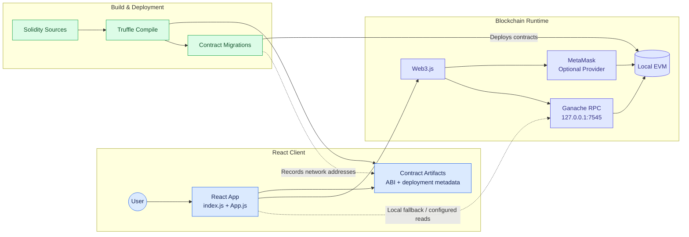
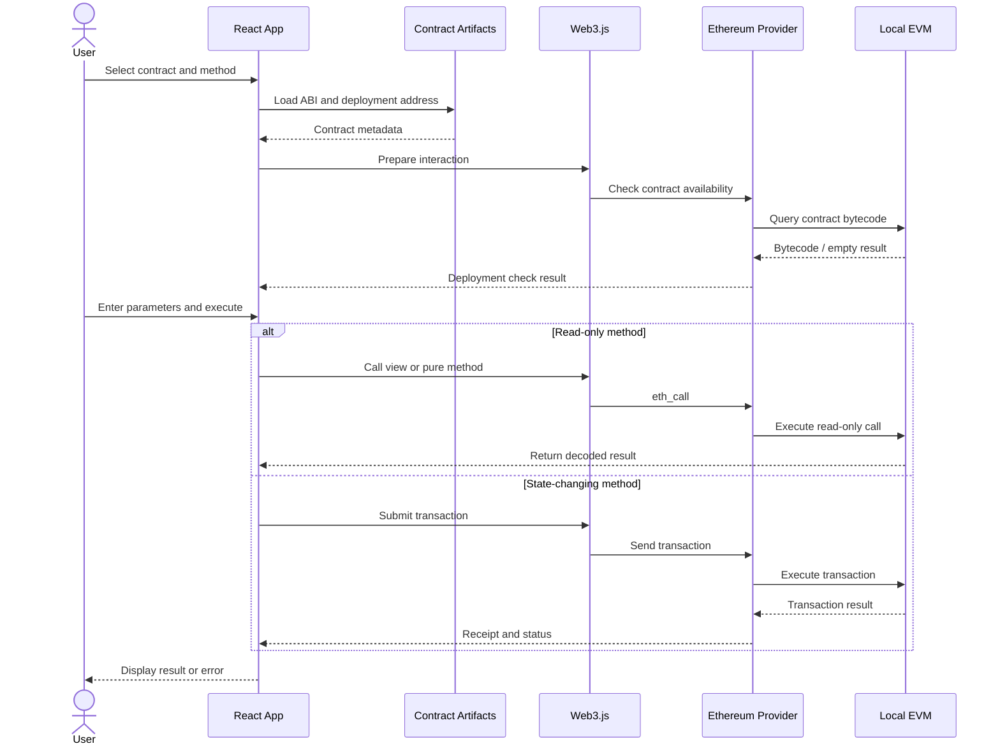

# ⛓️ Ethereum Smart Contract Playground
<p align="center">
  <strong>An interactive decentralized application for exploring and interacting with Ethereum smart contracts.</strong>
</p>

<p align="center">
  
  
  
  
  
</p>

## 📌 Overview

**Ethereum Smart Contract Playground** is an educational decentralized application (dApp) built with React, Web3.js, Solidity, Truffle, and Ganache.

The project provides a web interface for exploring and interacting with Solidity smart contracts deployed on a local Ethereum-compatible blockchain. It brings together several exercises covering arithmetic operations, Ether conversion, string manipulation, conditional logic, dynamic arrays, inheritance, and ETH payments.

The React frontend uses Truffle-generated contract artifacts to access contract ABIs and deployment information. Web3.js enables communication with Ethereum-compatible providers, allowing users to call contract methods, submit transactions, inspect blockchain information, and explore emitted events.

This project demonstrates how frontend development, smart contract engineering, and blockchain infrastructure work together in a decentralized application.

## ✨ Features

### 🔗 Blockchain Connectivity
- Connect to an injected Ethereum provider such as MetaMask.
- Use a local Ganache JSON-RPC endpoint when configured as the provider.
- Display blockchain network and account information.
- Inspect account balances and the latest block.
- Handle account and network changes where supported.

### 📜 Smart Contract Explorer
- Explore multiple Solidity contracts through a React interface.
- Load contract ABIs and deployment metadata from Truffle artifacts.
- Inspect available contract methods.
- Generate form inputs for contract method parameters.
- Display return values and execution errors.

### ⚡ Smart Contract Interaction
- Call read-only `view` and `pure` methods.
- Submit state-changing blockchain transactions.
- Supply ETH values when invoking payable methods.
- Inspect transaction status and related blockchain information.
- Check deployment information before interacting with contracts.

### 📡 Event Inspection
- Query events emitted by deployed contracts.
- Display event and transaction information.
- Refresh event information periodically.

### 🧪 Solidity Exercises
- Arithmetic and comparison operations.
- Ether and Wei conversion.
- String manipulation.
- Conditional statements and parity checking.
- Dynamic arrays and aggregation.
- Abstract contracts and inheritance.
- Payable functions, ETH transfers, and access restrictions.

## 🏗️ System Architecture

The application combines the React frontend, Solidity source files, Truffle compilation and deployment, and a local Ethereum-compatible blockchain.



**Architecture overview**

- `client/src/index.js` initializes the React application.
- `client/src/App.js` contains the main interface and contract interaction logic.
- Truffle compiles Solidity files and generates contract artifacts containing ABI and bytecode.
- Deployment migrations deploy contracts and record network-specific deployment information.
- Web3.js communicates with Ethereum-compatible providers.
- MetaMask can provide an injected wallet provider, while Ganache exposes a local JSON-RPC endpoint.

The diagram is a simplified overview of the architecture. Provider selection and read/write behavior depend on the implementation and the active network.

## 🔄 Contract Interaction Flow

The following diagram summarizes the main steps when a user interacts with a smart contract from the frontend.



This sequence illustrates the general interaction workflow; exact provider selection, transaction signing, and response handling depend on the active execution path.

## 📚 Smart Contracts

The repository includes the following Solidity exercises.

| Contract | Source File | Purpose |
|---|---|---|
| `Addition` | `contracts/Exercice1.sol` | Demonstrates arithmetic operations and function parameters. |
| `Convertisseur` | `contracts/Exercice2.sol` | Demonstrates conversion between Ether and Wei. |
| `GestionChaines` | `contracts/Exercice3.sol` | Explores string storage, concatenation, comparison, and related operations. |
| `Positif` | `contracts/Exercice4.sol` | Checks whether an integer is positive. |
| `Parite` | `contracts/Exercice5.sol` | Checks the parity of an integer. |
| `Tableau` | `contracts/Exercice6.sol` | Demonstrates dynamic arrays, element access, and aggregation. |
| `Forme` | `contracts/Exercice7/Form.sol` | Defines an abstract shape contract. |
| `Rectangle` | `contracts/Exercice7/Rectangle.sol` | Extends `Forme` with rectangle dimensions and area calculation. |
| `Payment` | `contracts/Exercice8.sol` | Demonstrates receiving ETH, access restrictions, and balance withdrawal. |

### Key Solidity Concepts

**Arithmetic and conditions**

`Addition`, `Positif`, and `Parite` demonstrate computations, comparisons, and conditional logic.

**Unit conversion and strings**

`Convertisseur` illustrates Ether denomination handling, while `GestionChaines` explores Solidity string operations.

**Data structures**

`Tableau` demonstrates storing and processing values in a dynamic array.

**Abstraction and inheritance**

`Forme` defines a shared abstraction, and `Rectangle` provides a concrete implementation of shape-related behavior.

**Payments and access restrictions**

`Payment` demonstrates payable functions, contract balances, event emission, and restricted withdrawals.

> These contracts are educational examples and should not be considered audited or production-ready.

## 🛠️ Technology Stack

| Technology | Purpose |
|---|---|
| **Solidity 0.8.21** | Implements the smart contracts. |
| **React 19** | Builds the browser-based user interface. |
| **Web3.js 4.x** | Connects the frontend to Ethereum-compatible providers and contracts. |
| **Truffle** | Compiles contracts, generates artifacts, and manages deployment migrations. |
| **Ganache** | Provides a local Ethereum-compatible blockchain for development. |
| **MetaMask** | Optional browser wallet and injected Ethereum provider. |
| **JavaScript** | Implements the frontend and blockchain integration. |
| **Mermaid** | Documents application architecture and interaction workflows. |

## 📂 Project Structure

```text
blockchain_project/
├── client/
│   ├── public/
│   ├── src/
│   │   ├── contracts/               # Generated Truffle artifacts
│   │   ├── App.js                   # Main dApp interface
│   │   ├── index.js                 # React entry point
│   │   └── reportWebVitals.js       # Performance measurement helper
│   └── package.json                 # Frontend dependencies and scripts
├── contracts/
│   ├── Exercice1.sol                # Addition
│   ├── Exercice2.sol                # Ether/Wei conversion
│   ├── Exercice3.sol                # String operations
│   ├── Exercice4.sol                # Positive-number check
│   ├── Exercice5.sol                # Parity check
│   ├── Exercice6.sol                # Dynamic arrays
│   ├── Exercice7/
│   │   ├── Form.sol                 # Abstract shape
│   │   └── Rectangle.sol            # Rectangle implementation
│   └── Exercice8.sol                # ETH payment
├── migrations/                      # Contract deployment migrations
├── test/                            # Contract test files, if configured
├── truffle-config.js                # Truffle and compiler configuration
└── README.md
```

Truffle-generated JSON artifacts provide contract ABIs, bytecode, and network-specific deployment information used by the frontend.

## ⚙️ Prerequisites

Prepare the following tools:

- **Node.js and npm**
- **Truffle CLI** or the ability to run Truffle through `npx`
- **Ganache Desktop or Ganache CLI**
- **MetaMask**, for injected-wallet interactions
- **Git**

Verify Node.js and npm:

```bash
node --version
npm --version
```

## 🚀 Installation and Setup

### 1. Clone the Repository

```bash
git clone https://github.com/Ellouzati-Mohammed/blockchain_project.git
cd blockchain_project
```

### 2. Install Frontend Dependencies

```bash
cd client
npm install
cd ..
```

### 3. Start Ganache

The application is configured to use the local JSON-RPC endpoint:

```text
http://127.0.0.1:7545
```

Start Ganache Desktop with its RPC server configured to use port `7545`, or start Ganache CLI:

```bash
npx ganache --server.port 7545
```

Keep Ganache running while compiling, deploying, and testing the contracts.

### 4. Configure the Truffle Development Network

If the `development` network is commented out in `truffle-config.js`, enable or add the following entry inside `module.exports.networks`:

```javascript
development: {
  host: "127.0.0.1",
  port: 7545,
  network_id: "*"
},
```

Preserve the existing Solidity compiler settings and the artifact output directory pointing to `client/src/contracts`.

### 5. Compile the Smart Contracts

Run from the project root:

```bash
npx truffle compile
```

Truffle compiles the Solidity sources and generates the contract artifacts.

### 6. Deploy the Contracts

With Ganache running and the development network configured:

```bash
npx truffle migrate --reset --network development
```

After successful deployment, Truffle records the deployment information for the configured network in the generated contract artifacts.

### 7. Start the React Application

```bash
cd client
npm start
```

Open the local URL printed in the terminal. For a standard Create React App setup, it is usually:

```text
http://localhost:3000
```

The exact command and URL depend on the scripts configured in `client/package.json`.

## 🧑‍💻 Using the Application

1. Start Ganache and deploy the contracts.
2. Launch the React frontend.
3. Check the network and account information displayed in the application.
4. Select a contract from the catalogue.
5. Choose a method and enter the required parameters.
6. Call a read-only method to inspect its result or submit a transaction to modify contract state.
7. When testing `Payment`, provide the intended ETH value in Wei for payable calls.
8. Inspect the displayed result, transaction details, and contract events.

### Ether and Wei Reference

| ETH | Wei |
|---:|---:|
| `1 ETH` | `1000000000000000000 Wei` |
| `0.1 ETH` | `100000000000000000 Wei` |
| `0.01 ETH` | `10000000000000000 Wei` |

Make sure to provide the denomination expected by the interface and the relevant payable method.

## 🧪 Testing and Build

Run these commands from the project root where applicable:

```bash
npx truffle compile
npx truffle test
```

Run frontend scripts from `client/`:

```bash
npm test
npm run build
```

The available test and build scripts depend on the repository configuration. Check the existing test files and `package.json` scripts before assuming that every command is configured.

## 🔧 Troubleshooting

### Contract Not Found or Not Deployed

- Ensure Ganache is running at `127.0.0.1:7545`.
- Compile the contracts.
- Run Truffle migrations against the correct network.
- Check that the generated artifacts contain deployment information for the active network.

### Truffle Cannot Find the Development Network

Confirm that the `development` entry is enabled in `truffle-config.js` and that its host and port match Ganache.

### MetaMask Transaction Fails

- Unlock MetaMask and authorize the application to use an account.
- Connect MetaMask to the network where the contracts were deployed.
- Ensure the account has sufficient test ETH.
- Reload the application after changing networks or accounts.

### Read Calls Return Unexpected Results

- Check the input values and Solidity parameter types.
- Verify that the selected contract and deployment address are correct.
- Confirm that the frontend and local RPC refer to the intended deployment.
- Inspect the browser console and transaction details for errors.

### Read Calls Fail While MetaMask Is Connected

The provider-selection and read-call paths should be checked when troubleshooting this situation. If an operation uses the local RPC endpoint, make sure the contract is deployed on that Ganache instance.

## 🔒 Security Considerations

This project is intended for local development and education.

- Use test accounts and test ETH only.
- Do not use these sample contracts with real funds.
- The `Payment` contract has not been independently audited.
- Verify permissions before performing restricted operations.
- Keep deployment artifacts and network configuration consistent.
- Review smart-contract code for access-control, transfer, and arithmetic risks before reusing it in another application.

## 🗺️ Explore the Codebase

Explore the repository structure interactively with GitDiagram:

**[Open blockchain_project in GitDiagram](https://gitdiagram.com/ellouzati-mohammed/blockchain_project)**

The interactive diagram links the React entry point, dApp interface, contract artifacts, Solidity exercises, deployment migrations, and local blockchain components.

## 👨‍💻 Author

**Mohammed Ellouzati**

- GitHub: [@Ellouzati-Mohammed](https://github.com/Ellouzati-Mohammed)
- LinkedIn: [Mohammed Ellouzati](https://www.linkedin.com/in/mohammed-ellouzati-359873270)
- Email: [mohammedellouzati047@gmail.com](mailto:mohammedellouzati047@gmail.com)

---

<p align="center">
  <em>Learn blockchain development by compiling, deploying, and interacting with Solidity smart contracts.</em>
</p>
