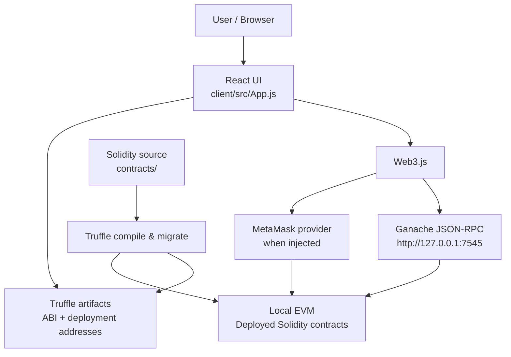
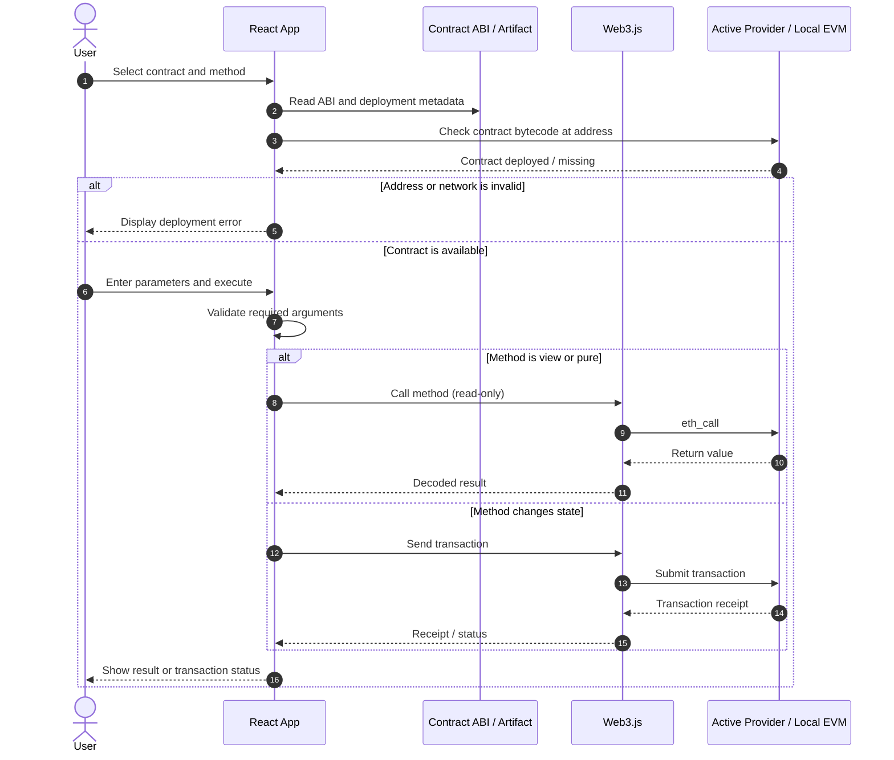

# Solidity Smart Contract Playground

<p align="center">
  <strong>Explore Ethereum smart contracts through React, Web3.js, Truffle, and Ganache.</strong>
</p>

<p align="center">
  
  
  
  
  
</p>

## Overview

**Solidity Smart Contract Playground** is an educational decentralized-application (dApp) interface for compiling, deploying, and interacting with Solidity smart contracts on a local Ethereum-compatible blockchain.

The React frontend uses **Web3.js** to connect to either an injected wallet such as MetaMask or a local Ganache JSON-RPC endpoint. It loads Truffle-generated contract artifacts, presents available contract methods, lets users call read-only functions or submit transactions, and displays blockchain and contract-event information.

Rather than implementing one large business workflow, the repository brings together several Solidity exercises covering basic calculations, type handling, arrays, inheritance, and a payable payment contract.

## Features

- **Wallet and network overview** — display the detected provider, network identifiers, available accounts, account balance, latest block, and recent transaction details.
- **Contract explorer** — select from the configured contract catalogue and inspect the methods and events exposed by each contract ABI.
- **ABI-driven interaction** — build method inputs from the selected contract's ABI, validate required parameters, and show returned values.
- **Read and write operations** — call `view`/`pure` methods without creating a transaction, or submit state-changing transactions through the active provider.
- **Payable method support** — specify an ETH value in Wei when invoking a payable method such as `Payment.receivePayment`.
- **Deployment checks** — compare the selected contract's recorded deployment network with the active network and verify that bytecode exists at the target address before execution.
- **Event inspection** — query past contract events, display transaction and block details, and refresh the event list periodically.
- **Wallet change handling** — react to MetaMask account, chain, and disconnect events.

## Architecture

The application has three main parts: the React client, the Truffle-generated contract artifacts, and the local Ethereum-compatible chain.



**Provider behavior:** the frontend uses the injected provider when `window.ethereum` is available; otherwise it falls back to the local Ganache endpoint. The current implementation routes read-only contract calls through the local RPC endpoint when an injected provider is detected. For consistent results, deploy the contracts to the local chain and ensure that MetaMask is connected to that same Ganache network before submitting transactions.

### Contract interaction flow



### Repository architecture diagram

Explore the codebase using GitDiagram:

👉 **[View the project on GitDiagram](https://gitdiagram.com/Ellouzati-Mohammed/blockchain_project)**

The Mermaid diagrams document the application runtime flow, while GitDiagram provides a navigable overview of source-file relationships.

## Smart Contracts

The React application registers the following contracts and presents their ABI methods in the interface.

| Contract | Purpose | Solidity concepts |
|---|---|---|
| `Addition` | Demonstrates arithmetic operations. | Functions, parameters, return values |
| `Convertisseur` | Converts between Ether and Wei. | Units, integer arithmetic |
| `GestionChaines` | Stores and manipulates strings. | State variables, strings, concatenation and comparison |
| `Positif` | Checks whether an integer is positive. | Conditions and comparisons |
| `Parite` | Checks whether an integer is even. | Modulo arithmetic |
| `Tableau` | Adds, reads, and sums values in a dynamic array. | Dynamic arrays and iteration |
| `Forme` | Defines a common shape abstraction. | Abstract contracts and inheritance |
| `Rectangle` | Implements a rectangle with dimensions, area, and information methods. | Inheritance and derived behavior |
| `Payment` | Receives ETH and allows the configured recipient to withdraw the contract balance. | `payable`, access checks, transfers and events |

> **Educational project:** these contracts are intended to demonstrate Solidity concepts. They should not be treated as audited or production-ready financial contracts.

## Technology Stack

| Technology | Role |
|---|---|
| **Solidity 0.8.21** | Smart contract language; the Truffle compiler configuration targets EVM version `paris`. |
| **Truffle** | Contract compilation, artifact generation, and deployment migrations. |
| **React 19** | Browser-based user interface. |
| **Web3.js 4.x** | Ethereum JSON-RPC interaction, contract calls, and transactions. |
| **Ganache** | Local Ethereum-compatible blockchain for development and testing. |
| **MetaMask** | Optional injected wallet for account access and transaction signing. |

## Project Structure

```text
blockchain_project/
├── contracts/                 # Solidity smart-contract sources
├── migrations/                # Truffle deployment scripts
├── test/                      # Contract test files
├── client/
│   ├── public/                # React public assets
│   ├── src/
│   │   ├── App.js             # Provider setup and contract interaction UI
│   │   ├── App.css            # Application styles
│   │   └── contracts/         # Truffle-generated JSON artifacts (ABI + networks)
│   └── package.json           # React and Web3.js dependencies/scripts
├── truffle-config.js          # Solidity compiler and build-output configuration
└── README.md
```

The Truffle configuration writes compiled artifacts to `client/src/contracts`, where the React application imports contract ABIs and deployment metadata.

## Prerequisites

- Node.js and npm
- Truffle CLI, installed globally or invoked with `npx`
- Ganache configured to listen on **`127.0.0.1:7545`**
- MetaMask browser extension (optional)

## Getting Started

### 1. Clone the Repository

```bash
git clone https://github.com/Ellouzati-Mohammed/blockchain_project.git
cd blockchain_project
```

### 2. Install Frontend Dependencies

```bash
cd client
npm install
cd ..
```

### 3. Start Ganache

Start Ganache on port `7545`, because that is the local RPC URL configured in the React application.

Using Ganache CLI:

```bash
npx ganache --server.port 7545
```

Alternatively, use Ganache Desktop and configure its RPC server to use `127.0.0.1:7545`.

### 4. Configure the Truffle Development Network

The `development` network example is commented out in the published `truffle-config.js`. Enable this entry inside `module.exports.networks`:

```javascript
development: {
  host: "127.0.0.1",
  port: 7545,
  network_id: "*"
},
```

Keep the existing Solidity compiler version (`0.8.21`) and artifact output directory (`./client/src/contracts`).

### 5. Compile and Deploy the Contracts

From the project root, with Ganache running:

```bash
npx truffle compile
npx truffle migrate --reset --network development
```

Deployment is required because the frontend uses deployment addresses stored in the Truffle-generated JSON artifacts.

### 6. Start the React Application

```bash
cd client
npm start
```

Open the local URL printed by Create React App, usually `http://localhost:3000`.

## Using the Application

1. Open the React application and check the provider and network information.
2. If using MetaMask, connect it to the same local Ganache chain where the contracts were deployed.
3. Select a contract from the catalogue.
4. Choose a method and provide the required arguments.
5. For a `payable` method, enter the transaction value in Wei.
6. Execute the method and inspect the returned value, transaction details, or emitted events.

### Testing the `Payment` Contract

`Payment.receivePayment` accepts a positive ETH payment. The UI expects the transaction value in Wei.

- `1 ETH = 1000000000000000000 Wei`
- `0.1 ETH = 100000000000000000 Wei`

After sending funds, invoke `withdraw` from the account configured as the contract's recipient. The withdrawal transfers the contract balance to that recipient.

## Useful Commands

Run these commands from the project root:

```bash
npx truffle compile
npx truffle migrate --reset --network development
```

Run frontend scripts from `client/`:

```bash
npm start
npm test
npm run build
```

## Troubleshooting

### The Contract Is Not Deployed at This Address

- Check that Ganache is running on `127.0.0.1:7545`.
- Confirm that the frontend and deployment network refer to the same chain.
- Recompile and redeploy with `npx truffle migrate --reset --network development`.
- Check that the artifacts in `client/src/contracts/` contain deployment addresses for the active network.

### MetaMask Cannot Submit a Transaction

- Connect MetaMask to the local Ganache network.
- Unlock MetaMask and authorize the application to use an account.
- Confirm that the account has test ETH on that local chain.
- After changing networks, reload the application and verify the displayed network.

### A Read-Only Call Fails Although MetaMask Is Connected

In the current frontend implementation, read-only contract calls use the local RPC endpoint when an injected provider is detected. Make sure the contract has also been deployed to the Ganache instance at `127.0.0.1:7545`.

### Truffle Reports That the `development` Network Is Unknown

The corresponding network block is commented out in `truffle-config.js`. Add the `development` configuration described in Step 4 and rerun the deployment command.

## Limitations and Security Notes

- This is a local learning project and is not intended for mainnet use.
- The sample `Payment` contract has not been independently audited. Do not send real funds to it.
- The application depends on local deployment artifacts and the configured Ganache network.
- Event history is queried from deployed contracts and refreshed by polling; it is not a separate persistent application database.
- Smart-contract calls and transactions can fail if inputs, network settings, addresses, or account permissions are incorrect.

## Author

**Mohammed Ellouzati**

- GitHub: [@Ellouzati-Mohammed](https://github.com/Ellouzati-Mohammed)
- LinkedIn: [Mohammed Ellouzati](https://www.linkedin.com/in/mohammed-ellouzati-359873270)
- Email: [mohammedellouzati047@gmail.com](mailto:mohammedellouzati047@gmail.com)

---

<p align="center"><em>Learning Ethereum development by building, deploying, and interacting with Solidity smart contracts.</em></p>
